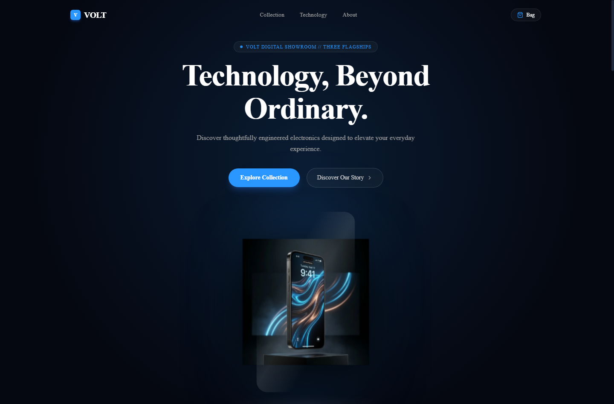
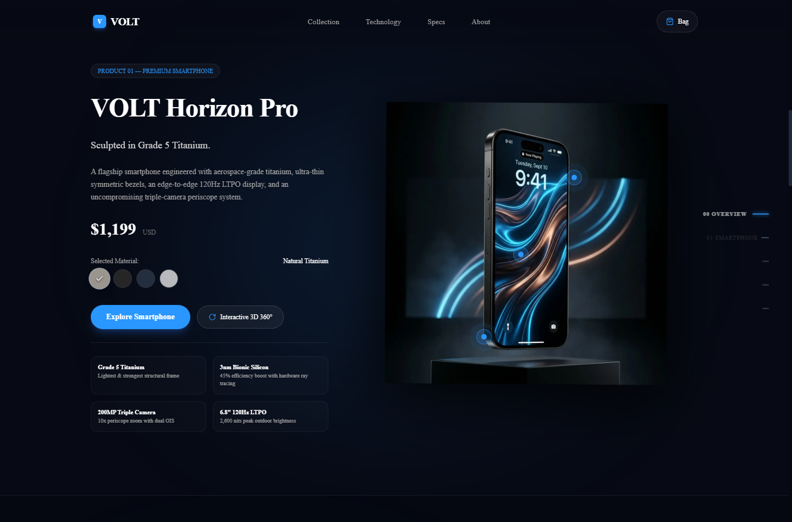
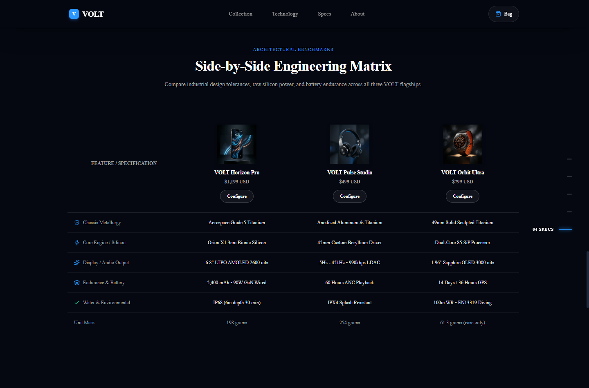
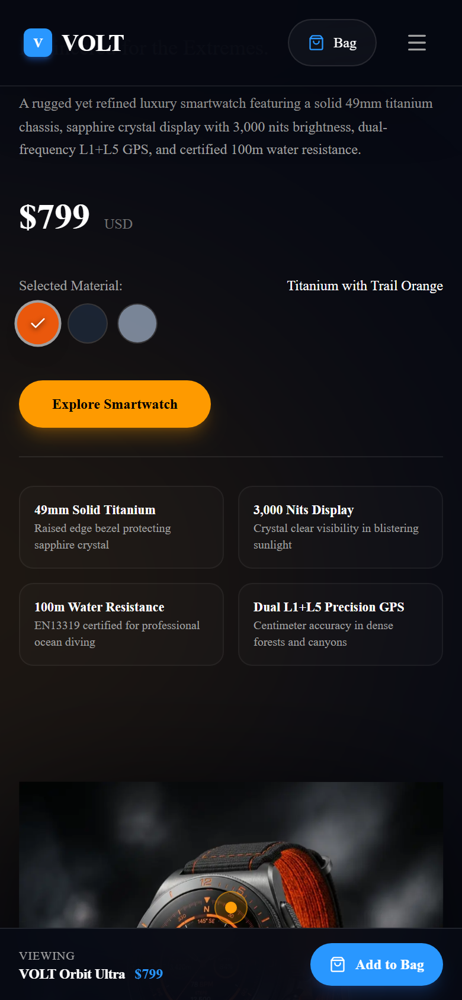

<div align="center">

# ⚡ VOLT — 3D Digital Showroom

**An award-winning, cinematic 3D e-commerce showroom for next-generation electronics.**  
Crafted with Next.js 16, React 19, Tailwind CSS, and UI/UX Pro Max Design Intelligence.

[](https://nextjs.org/)
[](https://react.dev/)
[](https://www.typescriptlang.org/)
[](https://tailwindcss.com/)
[](https://ui-ux-pro-max-skill.com)
[](https://www.w3.org/WAI/standards-guidelines/wcag/)

<br />



</div>

---

## 🌟 Overview

**VOLT** is an interactive, digital showroom for modern electronics that redefines high-end product presentation. Rejecting generic e-commerce templates and card grids, VOLT draws direct inspiration from Awwwards-winning websites, Apple keynote launches, and avant-garde industrial design.

The experience features **three meticulously engineered flagship products**, each celebrated in its own visual chapter with interactive 3D spatial hierarchy, live material configuration, pulsing engineering hotspots, and an architectural specification comparison matrix.

---

## 💎 The Three Featured Products

| # | Product | Metallurgy & Core Architecture | Display / Acoustics | Battery Endurance |
|---|---|---|---|---|
| **01** | **VOLT Horizon Pro** | Grade 5 Titanium Chassis • 3nm Orion X1 Silicon | 6.8" LTPO AMOLED 2,600 nits • 1-120Hz | 5,400 mAh • 90W GaN Wired |
| **02** | **VOLT Pulse Studio ANC** | Dual-Hinged Titanium • 45mm Beryllium Drivers | -48dB Adaptive Hybrid ANC • LDAC 990kbps | 60 Hours Studio Playback |
| **03** | **VOLT Orbit Ultra GPS** | 49mm Sculpted Titanium • EN13319 100m WR | 1.96" Sapphire Crystal 3,000 nits | 14 Days Normal / 36h GPS |

---

## 🚀 Key Features & Innovations

### 1. 🌌 Cinematic 3D Spatial Hero
* **Three-Dimensional Composition:** The flagship smartphone floats majestically above a dark studio pedestal, while the headphones and smartwatch reside in background atmospheric depth blur.
* **Pointer & Tilt Parallax:** Fluid response to mouse tracking with real-time specular reflections and dynamic lighting highlights.

### 2. 🔍 Interactive Engineering Hotspots

* Pulsing radar beacons placed directly over critical engineering components (periscope optics, LTPO OLED, titanium frame, beryllium acoustic transducers).
* Hovering or tapping reveals glassmorphic inspection cards detailing tolerances and technical schematics.

### 3. 🎨 Live Material & Color Swatch Switcher
* Real-time finish toggling across titanium alloys (Natural Titanium, Space Black, Deep Ocean Blue, Alpine Trail Weave).
* Tactile swatch controls with instant visual feedback and active state confirmation.

### 4. 📊 Side-by-Side Architectural Spec Matrix

* High-density comparison table comparing metallurgy, silicon engines, acoustic drivers, and environmental ingress protection side-by-side.
* Tabular monospace numerals (`tabular-nums`) ensuring readability and visual hierarchy.

### 5. 🛍️ Luxury Shopping Bag Drawer
* **Complimentary Express Courier:** Progress meter highlighting free worldwide courier unlocked.
* **VOLT Care+ Protection:** Optional 2-year accidental hardware warranty toggle with dynamic subtotal recalculation.
* **Simulated Express Checkout:** One-tap demo checkout via  Pay and Google Pay.
* **Full Keyboard Accessibility:** Seamlessly closes with `Escape`, maintains focus trap, and announces item updates through `aria-live="polite"`.

### 6. 📱 Mobile Sticky Action Bar

* Automatically appears on mobile devices when scrolling past the hero.
* Detects which product is in view and presents a high-contrast, one-tap **"Add to Bag"** button with tactile press animations.

---

## ♿ Accessibility & UX Compliance (UI/UX Pro Max)

Designed and audited under the **UI/UX Pro Max** framework:
- **WCAG 2.2 AA Contrast:** All typography exceeds 4.5:1 contrast against deep studio backgrounds (`#050811`, `#070A14`).
- **Touch Target Sizes:** Minimum 44×44px interactive areas for all steppers, buttons, and drawer triggers.
- **Keyboard Navigation:** Sequential `Tab` flow, skip-to-content anchor, visible focus rings (`focus-visible:ring-2`), and `Escape` key handlers.
- **Reduced Motion Support:** Respects `prefers-reduced-motion` to tone down 3D float physics and canvas transforms.

---

## 🛠️ Tech Stack

* **Framework:** [Next.js 16](https://nextjs.org/) (App Router, Turbopack)
* **Library:** [React 19](https://react.dev/)
* **Language:** [TypeScript 5](https://www.typescriptlang.org/)
* **Styling:** [Tailwind CSS](https://tailwindcss.com/)
* **Design Intelligence:** [UI/UX Pro Max](https://ui-ux-pro-max-skill.com)
* **Icons:** [Lucide React](https://lucide.dev/)
* **Audio & Graphics:** Canvas 2D / CSS 3D Matrix Transformations / Studio Lighting Models

---

## 📦 Getting Started

### Prerequisites
* [Node.js](https://nodejs.org/) (v18.18 or higher)
* `npm` or `pnpm` / `yarn`

### Installation

1. **Clone the repository:**
   ```bash
   git clone https://github.com/YOUR_USERNAME/volt-3d-showroom.git
   cd volt-3d-showroom
   ```

2. **Install dependencies:**
   ```bash
   npm install
   ```

3. **Start the local development server:**
   ```bash
   npm run dev
   ```

4. **Open in your browser:**
   ```text
   http://localhost:3000
   ```

---

## 🏛️ Project Structure

```text
volt-3d-showroom/
├── public/
│   ├── images/products/       # High-resolution studio product renders
│   └── showcase/              # GitHub README portfolio preview screenshots
├── src/
│   ├── app/
│   │   ├── globals.css        # Studio color tokens, font variables & scrollbars
│   │   ├── layout.tsx         # Root layout with Inter & JetBrains Mono typography
│   │   └── page.tsx           # Showroom chapters, annotations & modal integrations
│   ├── components/
│   │   ├── VoltCinematicHero.tsx      # Interactive 3D spatial canvas with mouse tracking
│   │   ├── InteractiveHotspot.tsx     # Pulsing beacons with engineering tooltips
│   │   ├── MaterialColorSwitcher.tsx  # Tactile material alloy selector
│   │   ├── SpecComparisonMatrix.tsx   # Side-by-side technical comparison table
│   │   ├── ChapterProgressRail.tsx    # Desktop floating chapter rail (01 // 02 // 03)
│   │   ├── MobileStickyActionBar.tsx  # Mobile bottom quick-bag sticky bar
│   │   ├── VoltProductModal.tsx       # Detail configurator & spec sheet modal
│   │   ├── QuoteDrawer.tsx            # Luxury shopping bag drawer with Care+ toggle
│   │   ├── Header.tsx                 # Frosted glass navbar with live item counter
│   │   └── Footer.tsx                 # Minimalist studio showroom footer
│   └── context/
│       └── store-context.tsx  # LocalStorage-backed cart & bag state management
└── package.json
```

---

## 📄 License & Attribution

Distributed under the **MIT License**.  
Designed & developed with precision for modern high-end web portfolios.
